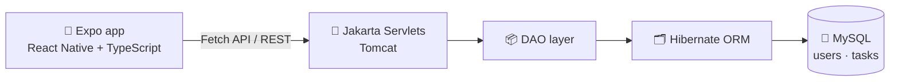
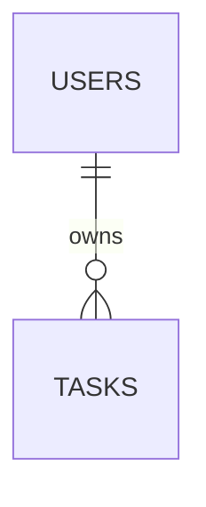

<div align="center">


<a href="https://github.com/Isuru-CodeX/Task-Tracker">
  
</a>

<br/>

<p>
  
  
  
  
  
  
</p>

<p>
  
  
  
  
  
</p>

<p>
  <a href="#-features"><b>✨ Features</b></a> •
  <a href="#-architecture"><b>🏗️ Architecture</b></a> •
  <a href="#-getting-started"><b>🚀 Get Started</b></a> •
  <a href="#-api-endpoints"><b>🔌 API</b></a> •
  <a href="#-roadmap"><b>🗺️ Roadmap</b></a>
</p>

</div>

---

## 📝 About

**TaskTracker** helps individuals organize, manage and track their daily tasks and priorities. A **Java backend** (Jakarta Servlets and Hibernate ORM) stores everything in **MySQL**, while a **React Native + Expo** mobile app gives you a clean native experience on both iOS and Android.

Whether it's personal to-dos or longer-term project deliverables, TaskTracker keeps each user's tasks private and organized through simple REST endpoints.

<!--
📸 SCREENSHOTS: add your images to an /assets folder, then uncomment this block.

<div align="center">
  
  
  
</div>
-->

---

## ✨ Features

| | Feature | Details |
|---|---|---|
| 🔐 | **User authentication** | Registration, login and session management |
| ✅ | **Full task CRUD** | Create, read, update and delete daily tasks and to-dos |
| 👤 | **Per-user tasks** | Account isolation, so each task belongs to exactly one user |
| 🗄️ | **Reliable persistence** | Hibernate ORM with MySQL storage |
| 📱 | **Cross-platform mobile app** | One React Native / Expo codebase for iOS and Android |

---

## 🏗️ Architecture



- **📱 Frontend:** functional components and hooks, file-based navigation with **Expo Router**, networking through the Fetch API
- **☕ Backend:** a monolithic Java service on Apache Tomcat that handles requests and business logic, with Hibernate mapping `User` and `Task` models to the schema
- **🐬 Database:** two normalized tables, `users` and `tasks`, linked one-to-many by the `fk_tasks_users` foreign key



---

## 🛠️ Tech Stack

<div align="center">


</div>

| Layer | Technologies |
|---|---|
| **Frontend** | React Native, Expo, TypeScript |
| **Backend** | Java, Jakarta Servlets, Hibernate ORM |
| **Database** | MySQL 8.0+ |
| **Tools** | Maven, Apache Tomcat, Node.js, Git, HeidiSQL / MySQL Workbench |

---

## 🚀 Getting Started

### ✅ Prerequisites

- ☕ **JDK 11** or higher
- 📦 **Apache Maven**
- 🐬 **MySQL Server 8.0+**
- 🐱 **Apache Tomcat** (v9+ / v10+)
- 🟢 **Node.js** (for the frontend)
- 🔧 **Git**

### 📥 Installation

```bash
git clone https://github.com/Isuru-CodeX/Task-Tracker.git
cd Task-Tracker
```

### 🗄️ Database setup

1. Open HeidiSQL, MySQL Workbench or the CLI
2. Create the database
3. Import the schema and seed data:

```sql
SOURCE database/database.sql;
```

### ⚙️ Configuration

Set your database credentials as environment variables so Hibernate can read them:

```bash
export DB_USER=YOUR_MYSQL_USERNAME
export DB_PASSWORD=YOUR_MYSQL_PASSWORD
```

> 🔒 **Never commit real passwords or API keys.**

### ▶️ Run it

**1️⃣ Backend**

```bash
cd back-end
mvn clean package
```

Deploy the generated `.war` to Tomcat, or run it from IntelliJ IDEA / Eclipse.

**2️⃣ Frontend** *(in a new terminal)*

```bash
cd font-end
npm install
npm start
```

Then open the app in an emulator, or scan the QR code with **Expo Go** on your phone.

---

## 🔌 API Endpoints

| Method | Endpoint | Description |
|:---:|---|---|
| `POST` | `/SignupServlet` | 📝 Register a new user |
| `POST` | `/LoginServlet` | 🔑 Authenticate an existing user |
| `GET` | `/GetTasksServlet` | 📋 Fetch tasks for the user |
| `POST` | `/AddTaskServlet` | ➕ Add a new task |
| `POST` | `/UpdateTaskServlet` | ✏️ Update an existing task |
| `POST` | `/DeleteTaskServlet` | 🗑️ Delete a task |

---

## 📂 Project Structure

```bash
Task-Tracker/
├── 📁 back-end/     # Java Servlet + Hibernate API (Maven project)
├── 📁 database/     # Schema and seed SQL scripts
├── 📁 font-end/     # React Native (Expo) client
├── 📄 .gitignore
└── 📄 README.md
```

<details>
<summary><b>🔍 Detailed component breakdown (click to expand)</b></summary>

<br/>

**📱 Frontend (`font-end/`)**

| Folder | Purpose |
|---|---|
| `app/` | Expo Router screens (e.g. `login.tsx`, `tasks.tsx`) |
| `services/` | API logic (`api.ts`) and local storage (`authStorage.ts`) |
| `models/` | TypeScript interfaces such as `Task.ts` |
| `assets/` | Fonts and images |

**☕ Backend (`back-end/src/main/java/`)**

| Folder | Purpose |
|---|---|
| `servlet/` | Controllers handling incoming HTTP requests |
| `model/` | JPA entities mapped to database tables |
| `dao/` | Data Access Objects talking to Hibernate |
| `config/` | `HibernateUtil` and other session configuration |

**🗄️ Database (`database/`)**

- `database.sql`: creates the schema and seeds initial test data

</details>

---

## 🧪 Testing

**Frontend**

```bash
cd font-end
npm run test
npm run lint
```

**Backend:** no automated test suite yet. JUnit tests for servlets and Hibernate mappings are planned.

---

## ⚠️ Known Issues

- The sandbox environment may lack a pre-configured MySQL/MariaDB server, so database-dependent backend code can't run without mocking.
- The `jest-expo` version must match the installed `expo` version in `font-end/`, or Jest suites will fail.

---

## 🗺️ Roadmap

- [x] User registration and login
- [x] Full task CRUD with per-user isolation
- [x] React Native / Expo mobile client
- [ ] JUnit test suite for the backend
- [ ] Better error handling and input validation (servlets and forms)
- [ ] Categories, due dates and reminders
- [ ] Token-based auth (**JWT**) instead of sessions

---

## 🤝 Contributing

Contributions are welcome! For major changes, please open an issue first to discuss what you'd like to change.

1. 🍴 Fork the project
2. 🌿 Create a branch: `git checkout -b feature/AmazingFeature`
3. 💾 Commit: `git commit -m "Add AmazingFeature"`
4. 📤 Push: `git push origin feature/AmazingFeature`
5. 🔃 Open a Pull Request

## 📜 License

Open source under the [MIT License](https://github.com/Isuru-CodeX/Task-Tracker/blob/main/LICENSE).

---

<div align="center">

### 📬 Connect with me

<a href="https://github.com/Isuru-CodeX"></a>

⭐ **If you like TaskTracker, give it a star!** ⭐


</div>